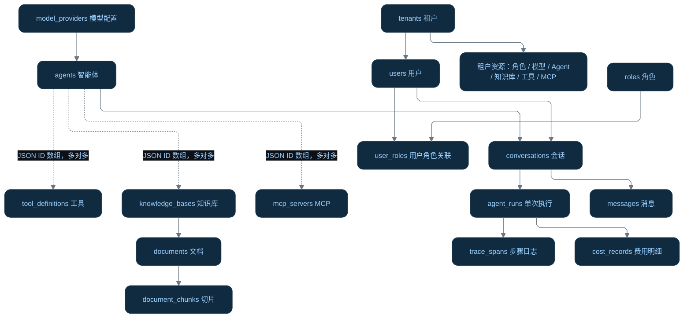

| 表名 | 作用 | 关键关联字段 |
|---|---|---|
| `tenants` | 租户，即企业或组织，作为资源隔离边界 | `id`、唯一的 `code` |
| `users` | 用户账号，保存登录信息、启用状态、管理员标记 | `tenant_id` |
| `roles` | 租户内的权限角色，权限列表存于 JSON 字段 `permissions` | `tenant_id` |
| `user_roles` | 用户与角色的关联表，支持一个用户拥有多个角色 | `user_id`、`role_id` |
| `model_providers` | 模型调用配置：提供方、模型名、接口地址、密钥引用及单价 | `tenant_id` |
| `agents` | 智能体配置：提示词、模型、知识库、工具、MCP、模式和版本 | `model_provider_id`、三组资源 ID 数组 |
| `knowledge_bases` | 知识库配置，组织文档并记录向量相关配置 | `tenant_id` |
| `documents` | 上传文件的元数据：文件名、路径、类型、处理状态 | `kb_id`、`tenant_id` |
| `document_chunks` | 文档切片正文、来源、Token 数及向量索引 ID | `document_id`、`kb_id`、`vector_id` |
| `tool_definitions` | 工具定义：参数 schema、风险等级、审批标记、启用状态 | `tenant_id` |
| `mcp_servers` | MCP 服务配置：启动命令、参数、工具名称列表 | `tenant_id` |
| `conversations` | 会话容器，记录谁与哪个 Agent 对话 | `tenant_id`、`user_id`、`agent_id` |
| `messages` | 会话中的逐条消息，保存角色和正文 | `conversation_id` |
| `agent_runs` | Agent 每次执行的记录：状态、最终回答、总 Token 和费用 | `conversation_id`、`user_id`、`agent_id` |
| `trace_spans` | 执行步骤日志，例如检索、工具调用、模型调用及耗时 | `run_id`、`trace_id`、`parent_span_id` |
| `cost_records` | 调用用量与费用明细，支持按用户、Agent、模型统计 | `run_id`、`tenant_id`、`user_id`、`agent_id` |
| `audit_logs` | 操作审计，记录操作者、动作、资源和细节 | `user_id`、`resource_type`、`resource_id` |

